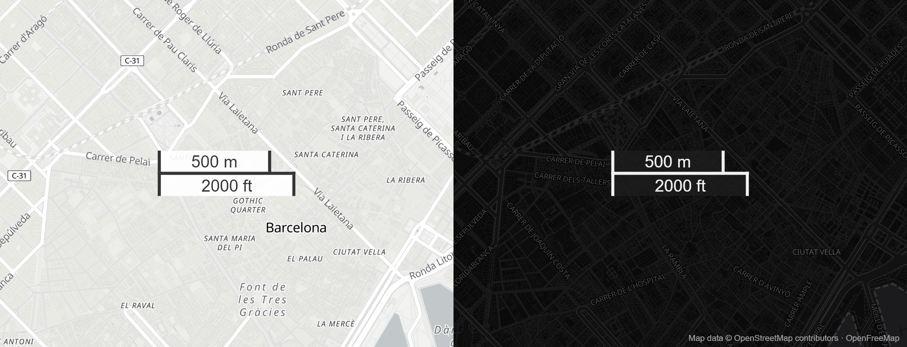
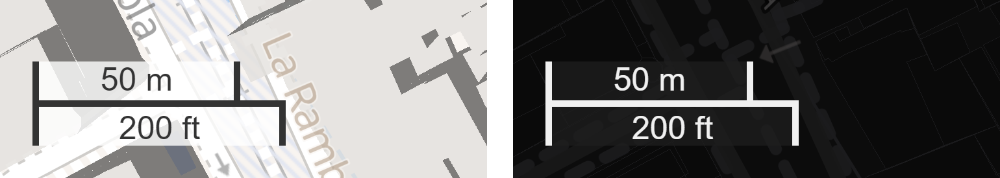

# maplibre-gl-dual-scale-control

**A scale bar for [MapLibre GL JS](https://maplibre.org/maplibre-gl-js/docs/) that shows metric and imperial units at the same time**, sharing a single axis. No more choosing between kilometres and miles, or stacking two `ScaleControl`s and hoping they line up.

[](https://www.npmjs.com/package/maplibre-gl-dual-scale-control)
[](https://github.com/p-rubi/maplibre-gl-dual-scale-control/actions/workflows/ci.yml)
[](LICENSE)



**[Live demo](https://p-rubi.github.io/maplibre-gl-dual-scale-control/demo/)**: try every option, switch corners, theme and MapLibre version.

## Features

- Metric bar above the axis, imperial bar below it (km / m and mi / ft), both updating as you pan, zoom and resize.
- Measures the same distance as MapLibre's built-in `ScaleControl`, so the numbers match what users already expect.
- Works in any corner: `addControl(control, 'top-right')` just works.
- Light and dark themes, plus CSS custom properties to restyle everything.
- Optional live coordinates under the mouse pointer.
- Tiny (about 3 kB minified), no dependencies, TypeScript types included.
- Tested with MapLibre GL JS 4, 5 and 6.



## Installation

```bash
npm install maplibre-gl-dual-scale-control
```

You can also install straight from GitHub:

```bash
npm install p-rubi/maplibre-gl-dual-scale-control
```

## Usage

Import the control and its stylesheet:

```js
import maplibregl from 'maplibre-gl';
import DualScaleControl from 'maplibre-gl-dual-scale-control';
import 'maplibre-gl-dual-scale-control/style.css';

const map = new maplibregl.Map({ /* ... */ });

map.addControl(new DualScaleControl(), 'bottom-left');
```

### With a `<script>` tag

```html
<link rel="stylesheet" href="https://cdn.jsdelivr.net/npm/maplibre-gl-dual-scale-control/src/style.css" />
<script src="https://cdn.jsdelivr.net/npm/maplibre-gl-dual-scale-control"></script>

<script>
  map.addControl(new DualScaleControl({ maxWidth: 120 }), 'bottom-left');
</script>
```

### CommonJS

```js
const DualScaleControl = require('maplibre-gl-dual-scale-control');
```

## Options

| Option                | Type                  | Default   | Description                                          |
| --------------------- | --------------------- | --------- | ---------------------------------------------------- |
| `maxWidth`            | `number`              | `100`     | Maximum length of the bars, in pixels.               |
| `theme`               | `'light'` \| `'dark'` | `'light'` | Colour theme. Use `'dark'` on dark basemaps.         |
| `showCoordinates`     | `boolean`             | `false`   | Show the longitude/latitude under the mouse pointer. |
| `coordinatePrecision` | `number`              | `6`       | Decimal places of the displayed coordinates.         |

```js
map.addControl(
  new DualScaleControl({ maxWidth: 150, theme: 'dark', showCoordinates: true }),
  'bottom-right'
);
```

## Styling

The control is styled with CSS custom properties, so you can adjust it without overriding rules:

```css
.maplibregl-ctrl-dual-scale {
  --dual-scale-color: #0a5c36;
  --dual-scale-background: rgba(255, 255, 255, 0.9);
}
```

| Property                       | Default                    | Description                                    |
| ------------------------------ | -------------------------- | ---------------------------------------------- |
| `--dual-scale-color`           | `#333`                     | Text and line colour.                          |
| `--dual-scale-background`      | `rgba(255, 255, 255, 0.8)` | Label background.                              |
| `--dual-scale-line`            | `2px`                      | Thickness of the axis and the end ticks.       |
| `--dual-scale-padding`         | `5px`                      | Horizontal padding of the labels.              |
| `--dual-scale-gap`             | `2.5px`                    | Space between the text and the axis.           |

The bars use `box-sizing: border-box`, so a bar is exactly as long as the distance it represents.

## Why not two `ScaleControl`s?

MapLibre's built-in [`ScaleControl`](https://maplibre.org/maplibre-gl-js/docs/API/classes/ScaleControl/) shows one unit at a time. Adding two of them stacks two separate boxes with their own borders. This control draws one shared axis, with the metric label above and the imperial label below, and keeps the spacing between each label and the axis identical.

## TypeScript

Types ship with the package:

```ts
import DualScaleControl, { type DualScaleControlOptions } from 'maplibre-gl-dual-scale-control';

const options: DualScaleControlOptions = { maxWidth: 120 };
map.addControl(new DualScaleControl(options));
```

## Development

```bash
git clone https://github.com/p-rubi/maplibre-gl-dual-scale-control.git
cd maplibre-gl-dual-scale-control
npm install
npm test        # unit tests for the scale maths
npm run build   # CommonJS and browser bundles into dist/
```

The demo in `demo/` imports the source directly, so serve the repository root with any static server and open `/demo/`.

## Credits and licence

This project began as a fork of [`mapbox-gl-dual-scale-control`](https://github.com/maphubs/mapbox-gl-dual-scale-control) by Kristofor Carle and MapHubs, Inc., which was in turn adapted from the default Mapbox GL scale control. It has since been rewritten for MapLibre GL JS.

Released under the [MIT licence](LICENSE). The original copyright notice is preserved.
